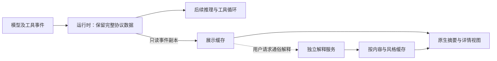

# DeepSeek Harness 思维链可读性：调研结果与设计决策

日期：2026-09-09。对象：本工作区 `@deepseek-ai/dsh@0.1.0-rc.6`、`@earendil-works/pi-ai@0.82.1`、Codex 公开实现及模型服务官方文档。

后续补充：[开源 agent 摘要实现与成本](OPEN-SOURCE-AGENTS.md)，核查 Cline、Roo Code、OpenCode，并区分 Thinking 展示、另发请求的行动摘要、上下文压缩和进度输出。

## 结论

存在可借鉴的实现。**把模型执行所用的推理状态与用户看到的说明分离，原生摘要由服务商提供，harness 负责展示**，是最有证据支持的路线。Claude 的官方文档明确证明：摘要由另一个模型生成，主推理模型看不到摘要；摘要生成不单独收费；关闭摘要降低延迟而不降低推理费用。它也明确有少量摘要延迟，因此不能把“免费摘要”说成“零计算、零延迟”。[S3][S4]

你的 harness 已通过 pi-ai 接入原生摘要能力，值得优先补齐设置与展示链路。这里要区分 **DeepSeek Harness 这个多模型宿主** 与 **DeepSeek 模型服务**：当前应用的默认模型是 Azure OpenAI 路由的 `gpt-5.4-mini`，DeepSeek 模型列表为空。该设置没有在本次调研中更改。

**推荐默认方案：原生摘要优先、展示副本独立、原始回传完整保留；现有摘要的显示密度在本地切换。** 若必须实现截图中的“把专业表达改写成普通用户能懂的话”，在供应商没有对应能力时，另设按需、异步、缓存的解释服务。它可以避免改动主推理和阻塞任务，但会产生额外生成成本；本地小模型也不能被计作零 token。

不建议以业务关键词模板，或本次验证的通用抽取算法，承担“通俗解释”的核心能力。后者在没有业务词典的情况下依然会漏掉纠正信息，且不会解释专业术语。

## 本次证据范围

- 已完成：官方资料核查、Codex/Gemini CLI 公开源码核查、当前 harness 全链路阅读、实际依赖的请求构造验证、DeepSeek 适配器合成 SSE 重放、独立观察器调度验证。
- 所有测试使用人工合成内容与假响应，**真实模型调用 0 次、实验计费 token 为 0**。这表示调研过程未调用付费模型，不表示摘要服务的真实成本是零。
- 未完成：真实 DeepSeek 模型质量 A/B、真实端到端延迟与账单测量、普通用户阅读测试。预算与目标接入已向用户询问，尚未得到回复；当前应用没有已配置的 DeepSeek 模型。
- DeepSeek 官方文档站多次连接失败，含获准后的网络重试。没有以搜索片段或第三方价格替代官方计费证据。因此，本报告对当前 DeepSeek 接口行为的直接依据是已安装官方适配器，**不据此断言所有 DeepSeek 端点永远不支持原生摘要**。
- 本地性能数据不是推理性能，也不是模型质量实验。没有“没有显著差异，所以绝对没有影响”的推断。

## 1. 三种成本不能混为一谈

| 项目 | 已确认的含义 | 是否由显示开关消除 |
|---|---|---|
| 主模型内部推理 token | 用于完成任务；OpenAI 与 Claude 明确按输出 token 计费；Gemini 文档按完整 thinking 计价 | 不能，隐藏摘要并不关闭推理 |
| 推理摘要生成 | 可能由另一个模型或服务过程执行 | 服务商决定生成与收费；Claude 明确不收摘要生成费 |
| 客户端显示、折叠、分段 | 操作已返回的内容 | 不新增模型生成，但有本地 CPU、内存与排版成本 |
| 对已有摘要再次改写 | harness 新增一次生成工作 | 除非复用已有缓存，否则有额外计算与 token |
| 后续上下文 | 推理状态、正文、工具结果的回传 | 必须按供应商协议保留；不能为了显示简短而截断 |

token 是计量单位，不是“屏幕字数”的同义词。对 DeepSeek 当前适配器，`completion_tokens` 被记为 `outputTokens`，`completion_tokens_details.reasoning_tokens` 另作明细，不能重复相加。`prompt_tokens` 含缓存命中，适配器拆成未缓存输入与缓存读取。完整供应商计费细则仍需官方资料或账单验证。[S7]

## 2. 各实现提供了什么证据

| 案例 | 摘要如何获得 | 成本结论 | 与主推理的关系 | 时间与迁移范围 |
|---|---|---|---|---|
| Codex / OpenAI | 同一 Responses 请求的 `reasoning.summary`；摘要事件流由客户端渲染 | 客户端没有第二次摘要模型调用；本次未找到足够官方证据确认摘要自身是否另收费 | `effort` 与 `summary` 独立字段；服务端完全隔离机制未公开确认 | 不能承诺零延迟；迁移前需核对模型和端点支持的档位 |
| Claude API | 原生 summarized thinking；官方明确由另一模型概述，主推理模型看不到概述 | 官方定价表明确摘要生成不收费，omitted 不降低主推理费 | 官方明确摘要对主推理不可见；客户端仍必须正确保留 signature/回传块 | 官方称少量附加延迟；omitted 可更早开始流式输出正文 |
| Gemini API / Gemini CLI | 服务端 thought summaries；CLI 解析原生粗体标题与描述 | 文档按完整 thought tokens 计价，不按短摘要字数估算；本次未确认与 Claude 同样明确的摘要零收费条款 | 文档要求完整保留 thought/signature；不能随意改写回传 | CLI 标题解析是无模型调用的显示加工；新版 Interactions 与旧 generateContent 字段不同 |
| 当前 DeepSeek 官方适配器 | `delta.reasoning_content` → `reasoning-delta` → 内容块 | 显示层没有新增摘要请求；usage 可保留 reasoning 明细 | 工具调用轮次将 reasoning 原文回传 | 当前请求构造没有独立 summary 字段；不支持从这个开关直接获得通俗改写 |

Claude 是本次最明确的“可以解耦且对客户不另收摘要费用”的证据。**服务商承担摘要生成，不等于整个系统不做额外计算。** 这正是产品成本与系统计算成本的区别。[S3][S4]

Codex 源码还存在实验性 `concurrent_reasoning_summaries` / `sequential_cutoff` 请求选项，所查提交默认关闭。它只能证明客户端有相应请求和事件处理能力，不能证明当前桌面版一定启用，也不能从命名推断服务端延迟为零。[S2]

## 3. 你的项目：链路、已有能力和接入陷阱

### 3.1 DeepSeek 路由

`dsh-llm-deepseek/lib/index.js`：

- 107–136 行构造请求，包含 `thinking` 与 `reasoning_effort`，没有独立摘要设置。
- 276 行附近接收 `reasoning_content` 并原样累计为推理块。
- 43–59 行序列化 assistant 消息；包含工具调用时回传 `reasoning_content`。
- 190 行附近映射 token usage。

因此，展示层应获得不可变的副本或只读引用；完整 reasoning 内容仍由运行时保管。禁止把用户看到的摘要覆盖到 `block.text` 后再回传。

### 3.2 多模型 pi-ai 路由

实际依赖已经具备这些能力：

- OpenAI Responses：`reasoningSummary` → `reasoning.summary`。
- Claude：`thinkingDisplay` → `thinking.display`，默认可返回 summarized thinking。
- Gemini：在对应思考配置下设置 `includeThoughts: true`。
- OpenAI 摘要事件被统一转换成 `thinking_delta`，harness 再映射为 `reasoning-delta`。

上层 `dsh-llm-pi-ai.profileOptions()` 尚未传递完整的摘要显示控制，且使用 `streamSimple()`。**简单加一个 UI 字段，然后把它透传进去，并不足以正确实现。**

本次使用真实的 pi-ai 请求构造函数，在网络发送之前截获请求，验证了以下结果（不是模型推理）：

| 调用方式 | 实际构造的请求 | 设计影响 |
|---|---|---|
| low-level stream：high + concise | high / concise | 可独立设置，但需支持相应模型档位 |
| low-level stream：high + detailed | high / detailed | 与上一组输入内容一致 |
| low-level stream：high + null | high / auto | **null 没有关闭摘要**，被默认值覆盖 |
| low-level stream：只给 concise | medium / concise | **可能意外改变原有推理强度** |
| streamSimple：high + concise | high / auto | **简化包装层丢掉摘要选项** |
| Claude adaptive high：summarized/omitted | effort 和 messages 相同，仅 display 不同 | 参数层可独立控制 |

这些结果针对 pi-ai 0.82.1、合成模型元数据；不是对当前 Azure 部署支持情况的确认。Azure 适配代码也存在类似默认值处理，但本次动态捕获运行的是 OpenAI Responses 与 Claude 构造器。

可选实施方式：在 adapter 中新增独立的 presentation 配置，并通过上游支持的请求生成入口或 `onPayload` 钩子**只修改允许的摘要字段**。关闭 OpenAI 摘要应在保持已解析 effort 的前提下省略 summary 字段；不能依赖该版本的 null 默认行为。挂钩逻辑需按供应商能力定义，不按任务关键词分支。[S8]

### 3.3 当前展示层

官方 `ReasoningRow` 在运行时取最后一行，完成后取第一行做折叠预览。桌面插件 `markReasoning()` 又将它覆盖为通用提示。工具活动描述由类别匹配和固定文案组成。

它们能表达运行状态，但不能证明已经满足截图中“普通用户看懂、专业用户看细”的语义要求。建议保留原生摘要正文及标题结构，并为来源区分 `provider-summary`、`reasoning-text`、`progress-message`、`tool-event`。这种来源元数据是协议适配，不是业务关键词模板。[S9][S10]

## 4. 离线实验与发现

### 4.1 数据与方法

12 个**人工合成**场景：中英文编码、数学、检索、文档审阅、规划、新工具名称、术语、长句、Unicode 等。每例通过当前已安装的 `DeepSeekAdapter` 实际解析 SSE，分别运行隐藏、短摘录、长摘录、全文四种展示，共 48 次模拟请求；另加 1 次观察器未返回时的主任务继续执行检查。

SSE 在 UTF-8 字节中间拆包，验证增量重建。包括工具调用历史及 reasoning 回传。所有网络调用均被进程内假响应拦截，没有调用真实供应商。

检查结果：

- 四种模式的出站请求 SHA-256 一致。
- 接收到的协议事件 SHA-256 一致。
- 回传 reasoning 与原文完全一致，Unicode 内容保持原样。
- 展示内容均可通过字符范围定位回原文。
- 改变展示没有多出模拟模型请求。
- 观察器响应暂不返回时，实际适配器仍完成相同的模拟主任务请求和事件流。

这证明了**原型的数据隔离与调用行为**，不证明任何真实模型在改动服务端参数后的质量不变。

### 4.2 通用抽取：有价值，但不足以做通俗解释

原型使用通用句子分割、字符 n-gram 相似度和图排序，无任务词典或业务模板，输出是带原文位置的摘录。

发现三个明确限制：

1. **遗漏纠正。** `negation` 案例的原文先讨论缓存，后明确排除缓存并定位两个监听器。短摘录选中旧缓存句和最后的测试计划，遗漏了关键纠正。即使每句话都来自原文，组合展示仍可能误导。
2. **术语不被解释。** `jargon` 案例保留了 linearization / CAS 等词，不会自动变成普通用户能懂的表达。
3. **长句难压缩。** `long-sentence` 案例几乎保持原长度。

因此，本原型不推荐作为“通俗解释”的默认实现，也不应加标签伪装为完整、可靠的语义摘要。它可作为有原文入口的辅助摘录，前提是产品确实需要这一功能。

### 4.3 本地耗时

Node 24.19.0、当前机器，预热后 100 次投影：

| 输入规模 | p50 | p95 |
|---|---:|---:|
| 2,040 字符 | 1.87 ms | 2.23 ms |
| 40,838 字符 | 2.62 ms | 3.68 ms |

这些是纯本地处理计时，未包含浏览器排版、线程通信、GPU 竞争、网络或模型推理。不能据此宣传“端到端零延迟”。算法限制了参与图排序的句子窗口，但仍需扫描输入，生产实现不能每收到一个 token 就全量重跑。

### 4.4 异步观察器

研究原型验证：10 个快速变化的快照合并为首个和最新两个模拟摘要作业；最多一个作业进行中；旧结果不覆盖新快照；同一快照缓存命中时不再发请求；摘要错误不会传播成主任务失败。

使用可控的未完成 Promise 模拟摘要服务，并验证主任务先行完成。**这是调度验证，没有生成真实摘要，也没有测量摘要模型质量。** 本地昂贵工作须移入 worker/独立进程，避免 Promise 包装下的同步计算仍阻塞主线程。[实验脚本](replay.mjs)

## 5. 推荐的产品与技术设计

### 5.1 将“现有内容怎么显示”和“后续生成什么摘要”分开

**现有内容的展示密度**可以即时切换：概要、展开、全部已有内容。切换只作用于已经收到的摘要/原文，不修改模型参数、不重跑任务、不触发解释调用。原生标题只有在返回结构存在时才提取，不从固定关键词编造语义。

**后续摘要的详略**使用供应商原生设置，保持 reasoning effort 不变，并明确只作用于后续生成。既有 concise 摘要不能仅通过本地展开变出从未收到的 detailed 解释。

**通俗/专业表达**单独看待。原生 concise/detailed 只表明详略，不能保证实现术语解释、面向新手的改写。若供应商没有此能力，则由按需解释服务完成，并明确其独立来源与生成状态。

### 5.2 架构



这是建议架构，不是对所有供应商内部实现的描述。关键约束：解释服务没有写入模型 history 的通道，主任务不等待解释完成。界面只消费当前 revision 匹配的结果。

能力元数据建议包含：`nativeSummary`、`supportedSummaryLevels`、`displayControl`、`reasoningReplayPolicy`、`billingEvidence`。按模型/端点的能力组织，未知能力保留为 unknown，不默认开启不支持的参数。

### 5.3 按需解释的成本控制

- 优先复用原生摘要；只在用户明确需要改写时启动额外解释。
- 以语义阶段/已完成段落/工具边界为候选更新点，设置最小间隔并合并过时快照；不要逐 token 请求。
- 同一时刻最多一个作业，新变化只保留最新候选。
- 缓存键包含内容哈希、表达风格、语言、解释模型与提示版本。
- 只传理解当前阶段所需的内容；保留明确 source refs。增量上下文不能随意丢弃纠正和约束，先验证再压缩。
- 缓存过的风格即时切换；没有缓存的风格会有首次生成费用和就绪延迟。不能把这部分隐去。
- 串行全量摘要的输入总量可能随阶段数增长过快。成本需按所有摘要调用实际 usage 累加，而非只数最后展示的一句话。

独立服务的增量计费近似为 `Σ(未缓存输入 × 输入单价 + 缓存输入 × 缓存单价 + 输出 × 输出单价)`；若供应商将内部推理包含在输出中，不能再加一次。图中旁路隔离可避免把摘要等待加入主任务关键路径，但共享本地资源仍需测量。

### 5.4 四个目标的最终回应

| 路线 | 额外 token/费用 | 主推理影响 | 泛化 | 时间 | 是否满足截图的语义要求 |
|---|---|---|---|---|---|
| 展示已有原生摘要，切换信息密度 | 切换本身为零；首次摘要费用看供应商，Claude 明确免摘要费 | 展示与回传隔离后不改模型输入；原生生成机制按供应商证据判断 | 不依赖业务模板，受模型能力限制 | 切换无需等待模型；原生生成可能有延迟 | 能提供更简短/更详细阅读，不保证通俗改写 |
| 通用原文抽取 | 无新增模型 token | 本地验证未改变请求和回传 | 算法跨领域，但语义可靠性不足 | 少量本地工作，可放 worker | **不足，不推荐担当核心功能** |
| 独立通俗解释服务 | 有额外生成 token；缓存复用后切换为零 | 不回灌、不修改主请求；仍须检验资源竞争和实际链路 | 模型语义泛化，不写业务模板；需评估忠实性 | 不阻塞主任务，解释自身会晚到 | 可针对截图目标实现，质量需真实模型与用户测试 |
| 在主推理 prompt 中要求按某种风格思考 | 改变输入，可能改变生成长度 | 直接改变推理输入，难满足不干预目标 | 可泛化，但不是独立展示控制 | 可能改变推理耗时 | 不作为推荐路线 |

**优先落地顺序：** 先补齐 pi-ai 原生摘要设置及来源元数据，确保完整回传，做已有内容的密度控制；确认实际 DeepSeek 模型/端点能力后接入原生字段；通俗改写作为独立按需能力。不给四个目标同时打上未经证实的“全部满足”，也不预先认定没有可行解。

## 6. 尚需真实实验回答的内容

当前真实模型/端点未确认，应用 DeepSeek 列表为空；未经预算回复没有使用其他已登录供应商替代进行付费实验。后续实验应分别测：

1. 原生摘要开关/详略：固定目标模型、effort、上下文、工具、输出上限，任务配对并随机顺序，记录完整 usage 与时间；不支持的档位标 N/A。
2. 独立解释：固定主任务记录，测语义忠实性、否定/纠正保留、术语解释和来源覆盖；不把“更短”当作“更易懂”。
3. 端到端：分别记录主任务结束和解释就绪，测试网络慢、解释错误、频繁快照、多轮回传及设备资源竞争。
4. 质量：标准答案、独立代码测试、工具任务成功率；评分者不看分组。由小试验估计变异与样本量，预先设定非劣效界限。不能用几个问题或“不显著”证明绝对不影响。

这部分仍未执行，不能从本报告导出 DeepSeek 真实质量差异、每任务美元成本或推理耗时差值。

## 7. 复现与文件

在项目根目录运行，两个脚本都不会调用真实 API：

```bash
node docs/research/reasoning-readability-2026-09-09/replay.mjs
node docs/research/reasoning-readability-2026-09-09/native-parameters.mjs
```

- [重放结果](results.json)：逐场景哈希、原文范围、模式对照、本地性能。
- [参数捕获结果](native-parameters.json)：实际依赖构造的请求关键字段。
- [抽取原型](projector.mjs)、[独立观察器](observer.mjs)、[合成案例](fixtures.mjs)。
- [证据清单](sources.json)：来源 URL/文件、快照哈希与核查范围。

本轮新增内容均在本研究目录，未修改生产代码或应用设置。

## 来源

- S1：[OpenAI reasoning guide](https://developers.openai.com/api/docs/guides/reasoning#reasoning-summaries)；[Responses reasoning 参数](https://developers.openai.com/api/reference/resources/responses/methods/create#responses-create-reasoning)。
- S2：[Codex 请求构造](https://github.com/openai/codex/blob/38cbebaf3fe3e81a94bf462079e7cf9659fc9e50/codex-rs/core/src/client.rs#L870)、[摘要事件](https://github.com/openai/codex/blob/38cbebaf3fe3e81a94bf462079e7cf9659fc9e50/codex-rs/codex-api/src/sse/responses.rs#L381)、[渲染](https://github.com/openai/codex/blob/38cbebaf3fe3e81a94bf462079e7cf9659fc9e50/codex-rs/tui/src/history_cell/messages.rs#L310)。核查的是公开 core/TUI，非私有桌面前端。
- S3：[Claude summarized thinking](https://platform.claude.com/docs/en/build-with-claude/thinking#summarized-thinking)；[display 控制](https://platform.claude.com/docs/en/build-with-claude/thinking#controlling-thinking-display)。
- S4：[Claude thinking pricing](https://platform.claude.com/docs/en/build-with-claude/thinking-steering-and-cost#pricing)。
- S5：[Gemini thinking](https://ai.google.dev/gemini-api/docs/thinking)，本次获取页面以 Interactions API 为主；本地 pi-ai 仍有 generateContent 路径，不混用字段或 token 口径。
- S6：[Gemini CLI 标题解析](https://github.com/google-gemini/gemini-cli/blob/ed2ac40df67a319bf348bd7e3d10494696b31b38/packages/core/src/utils/thoughtUtils.ts)、[展示组件](https://github.com/google-gemini/gemini-cli/blob/ed2ac40df67a319bf348bd7e3d10494696b31b38/packages/cli/src/ui/components/messages/ThinkingMessage.tsx)。
- S7：[DeepSeek 适配器](/Users/jesselai/Desktop/DSH-Desktop/node_modules/@deepseek-ai/dsh-llm-deepseek/lib/index.js:43)。
- S8：[harness pi-ai 适配器](/Users/jesselai/Desktop/DSH-Desktop/node_modules/@deepseek-ai/dsh-llm-pi-ai/lib/index.js:656)、[OpenAI 构造器](/Users/jesselai/Desktop/DSH-Desktop/node_modules/@earendil-works/pi-ai/dist/api/openai-responses.js:228)、[简化参数层](/Users/jesselai/Desktop/DSH-Desktop/node_modules/@earendil-works/pi-ai/dist/api/simple-options.js:10)、[Claude 构造器](/Users/jesselai/Desktop/DSH-Desktop/node_modules/@earendil-works/pi-ai/dist/api/anthropic-messages.js:758)。
- S9：[官方 ReasoningRow](/Users/jesselai/Desktop/DSH-Desktop/node_modules/@deepseek-ai/dsh-client-ui-conversation/lib/client.js:8998)。
- S10：[桌面展示逻辑](/Users/jesselai/Desktop/DSH-Desktop/plugins/@jesse-lai/dsh-desktop-ui/lib/client.js:3887)、[现有交互规范](/Users/jesselai/Desktop/DSH-Desktop/docs/progress-milestones.md)。
